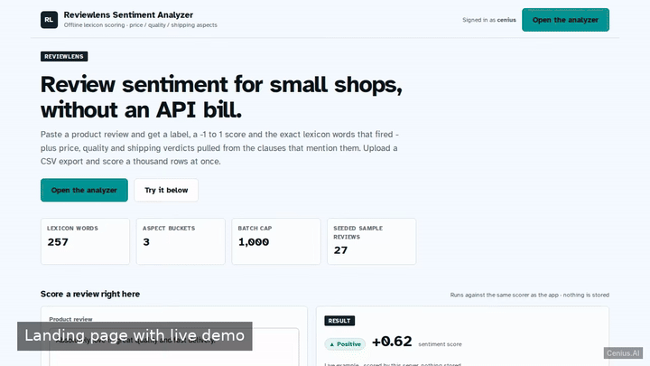
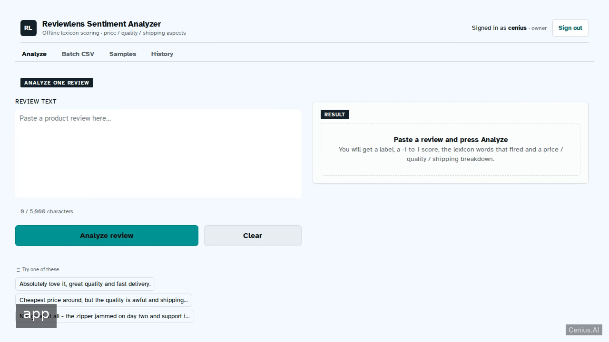
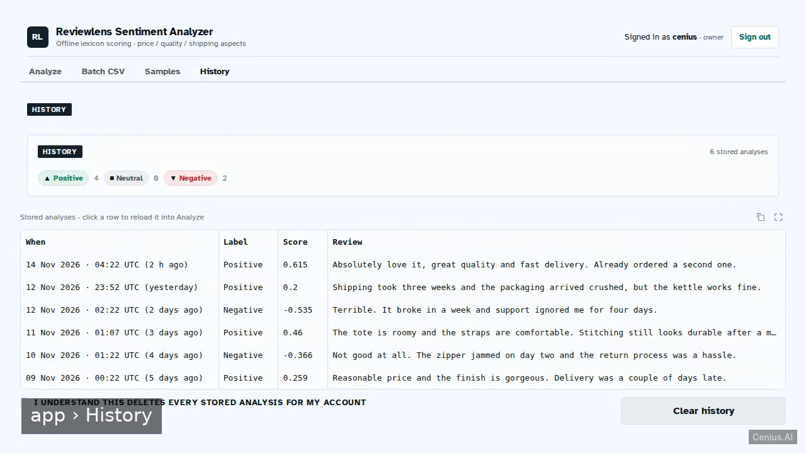
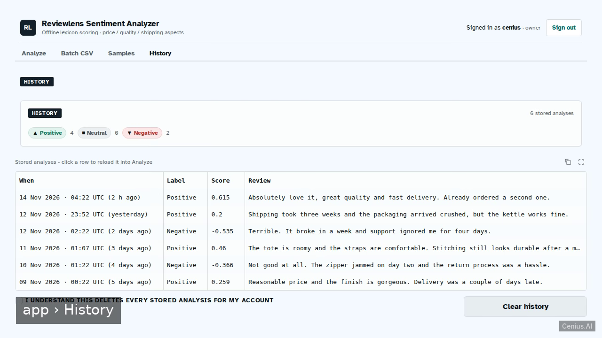

# Reviewlens Sentiment Analyzer — complete Full-stack app monitoring dashboard example app

This repository contains the complete source for **Reviewlens Sentiment Analyzer**, an open-source monitoring dashboard built with Full-stack app. Reviewlens Sentiment Analyzer is a self-hosted Gradio app that gives small e-commerce shops instant review sentiment without paying for an API. Everything Reviewlens Sentiment Analyzer needs to run is here — code, seed data, install scripts. Apache-2.0-licensed — use Reviewlens Sentiment Analyzer commercially, self-host it, or [remix Reviewlens Sentiment Analyzer on cenius.ai](https://cenius.ai/marketplace/p/reviewlens-sentiment-analyzer?ref=gh&utm_campaign=reviewlens-sentiment-analyzer-webapp) to make it yours.


[](LICENSE)  [](https://cenius.ai)

[](https://cenius.ai/marketplace/p/reviewlens-sentiment-analyzer?ref=gh&utm_campaign=reviewlens-sentiment-analyzer-webapp)

> **▶ [Open & edit in cenius.ai](https://cenius.ai/marketplace/p/reviewlens-sentiment-analyzer?ref=gh&utm_campaign=reviewlens-sentiment-analyzer-webapp)** — one click to an editable workspace: describe changes in plain English, get an instant preview, one-click deploy and host. Modifications made on the platform come with full rebrand & relicense rights.

_Local clone? See [Quick start](#quick-start) below. cenius.ai is the zero-setup path._

## Demo



▶ **[Video walkthrough](https://cenius.ai/marketplace/p/reviewlens-sentiment-analyzer?ref=gh&utm_campaign=reviewlens-sentiment-analyzer-webapp)** — see the app in action on the cenius.ai project page · [MP4 file](.github/media/demo.mp4)

## Screenshots

  

## Quick start

```bash
./install.sh   # installs dependencies + seeds demo data
```

See [`INSTALL.md`](INSTALL.md) for full setup and usage instructions.

## Features

- Single review sentiment analysis
- Aspect keyword extraction (price, quality, shipping)
- Batch CSV scoring with summary chart
- Sample review sets to try instantly
- Basic authentication
- Analysis history and persistence

## Architecture

No external services required: the entire monitoring dashboard runs from this Full-stack app repo (59 files). Top-level layout: `app/`, `data/`, `devtools/`, `tests/`. Starting up is just `./install.sh`: it installs what is needed and pre-fills the database so you have data to work with straight away. For environment-specific setup, see [`INSTALL.md`](INSTALL.md).

## Usage guide

Open <http://localhost:7860>. The page you land on is the **public overview**: what the
product does, a demo box that scores a review live against the real API (no account
needed, nothing stored) and the seeded sample review sets.

Press **Open the analyzer** to reach the workspace at `/app/` and sign in with
`cenius@cenius.ai` / `cenius`. It opens on the **Analyze** tab; the four tabs across the
top are Analyze, Batch CSV, Samples and History.

### Analyze one review

1. Paste a review into the textarea — the counter under it shows `0 / 5,000 characters`
   and updates as you type. Over 5,000 characters the counter turns into an inline error
   and nothing is scored.
2. Press **Analyze review** (or pick one of the three examples). The button shows a busy
   state while the review is scored — typically a couple of milliseconds.
3. The result card shows:
   - the label chip and the numeric score on a -1 to 1 gauge,
   - **Lexicon words that fired**, e.g. `great +0.80`, `good -0.68 · negated`,
   - the **aspect breakdown** — price / quality / shipping with a verdict, the mention
     count and the exact clause that produced it, or "No aspects detected",
   - the review text and a "Saved to your history · <time>" line.

Empty input shows "Paste a review to analyze" inline and writes nothing.

### Score a CSV export

_Full guide: [`USAGE.md`](USAGE.md)_

## FAQ

### How do I run Reviewlens Sentiment Analyzer on my own server?

Clone this repository and run `./install.sh`, then start the app as described in [`INSTALL.md`](INSTALL.md). Reviewlens Sentiment Analyzer is fully self-hostable — no external services are required to try it.

### What is Reviewlens Sentiment Analyzer built with?

Reviewlens Sentiment Analyzer runs on Full-stack app. This repo holds the full production source: you can inspect every part of it before deploying. Highlights include single review sentiment analysis.

### What license does Reviewlens Sentiment Analyzer use?

The code is under the Apache-2.0 license, which allows commercial use without restriction. You can build, sell, and deploy it freely. Full text: [LICENSE](LICENSE).

### How do I make Reviewlens Sentiment Analyzer my own brand?

White-labeling is supported: fork the MIT-licensed source and rebrand it yourself, or use [cenius.ai](https://cenius.ai/marketplace/p/reviewlens-sentiment-analyzer?ref=gh&utm_campaign=reviewlens-sentiment-analyzer-webapp) to make changes in a guided workspace — platform modifications come with full rebrand rights.

### Can I change Reviewlens Sentiment Analyzer without writing code?

Yes — [load it on cenius.ai](https://cenius.ai/marketplace/p/reviewlens-sentiment-analyzer?ref=gh&utm_campaign=reviewlens-sentiment-analyzer-webapp), describe the change in plain English, and you get back a fresh build with your modification applied.

## License & rebranding

Released under the [Apache License 2.0](LICENSE) (© 2026 Cenius AI) — free for personal and commercial use. The Cenius name/logo are trademarks (see NOTICE).

**Need a customized version?** [Remix this app on cenius.ai](https://cenius.ai/marketplace/p/reviewlens-sentiment-analyzer?ref=gh&utm_campaign=reviewlens-sentiment-analyzer-webapp) — modifications made on the platform come with **full rebrand & relicense rights** over your derivative.

## Built with cenius.ai

This entire application — code, design, seeded demo data — was generated on **[cenius.ai](https://cenius.ai)** from a plain-English description.

- 🚀 [Build your own app on cenius.ai](https://cenius.ai)
- 🎛️ [Remix Reviewlens Sentiment Analyzer on the marketplace](https://cenius.ai/marketplace/p/reviewlens-sentiment-analyzer?ref=gh&utm_campaign=reviewlens-sentiment-analyzer-webapp) — open it in a workspace, prompt for changes, and ship your own version.

More open-source apps: [the Cenius-ai catalog](https://github.com/Cenius-ai) · [showcase index](https://github.com/Cenius-ai/showcase)
